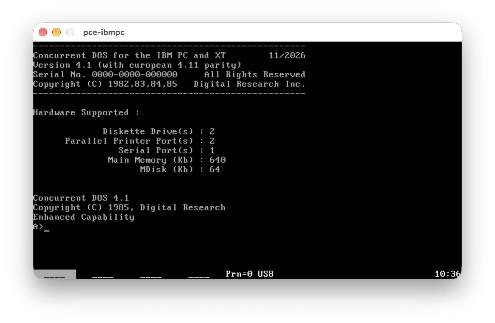
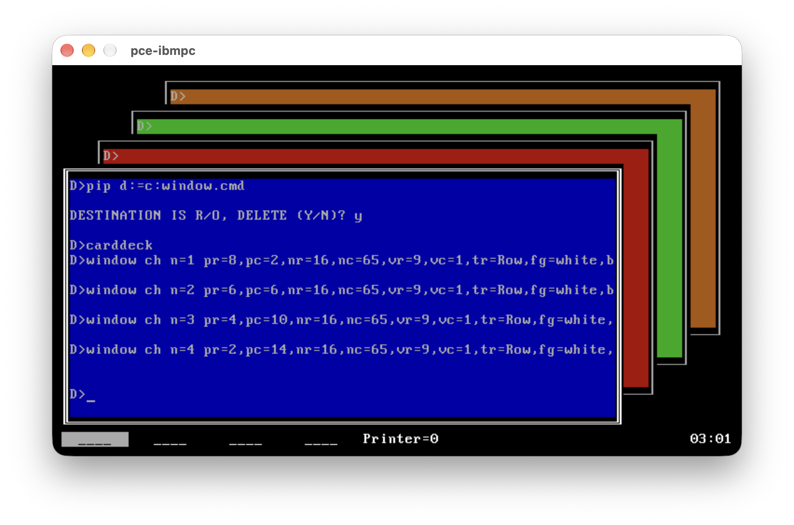
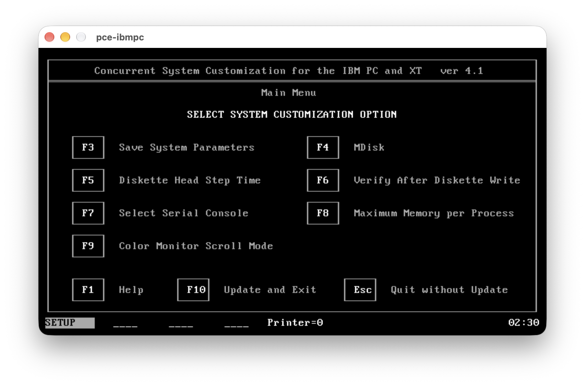
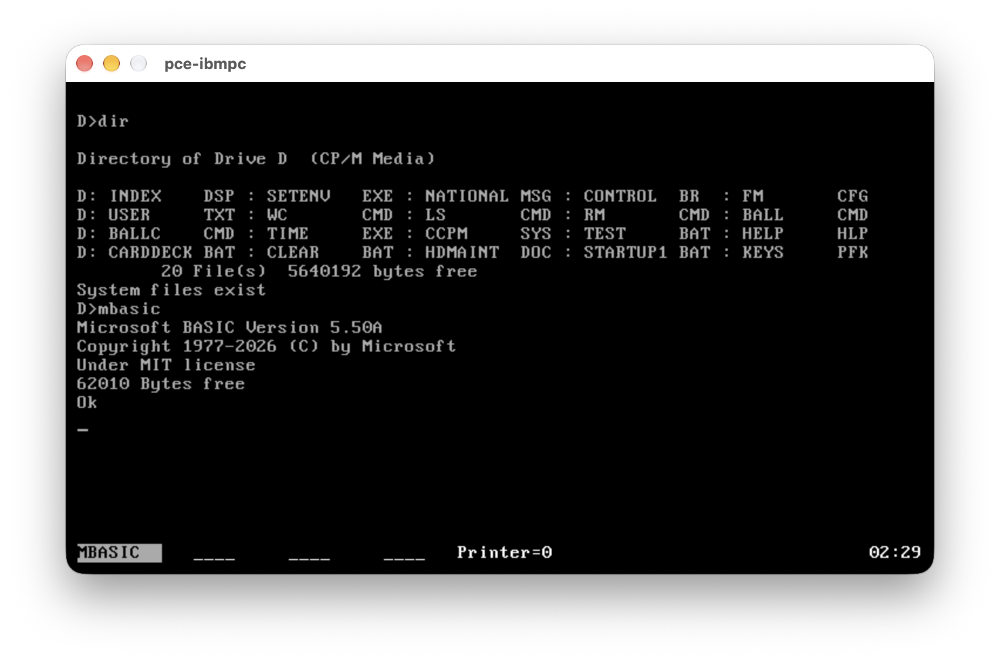

# Concurrent DOS 4.11 Kernel and Tools

**Disk Images are now available as part of the project releases, ready to use ! Full Source Build in Progress**

This project preserves Digital Research's Concurrent DOS 4.11, multitasking OS (CCP/M-86 follow up),
including PC-MODE DOS 2.0 Compatibility, as a usable, rebuildable system for running and exploring
classic 16-bit software. Runnable disks, development tools and patch notes
accompany the sources, with CP/M-Plus-style usability improvements. The assembly is based on partial 4.1 OEM sources corrected to align with European 4.11 and a lot of fixes and enhancements.

| Goal | Distribution |
| --- | --- |
| Source rebuild | Kernel, four RSP families, boot sources and command tools |
| Usability improvements | Command-line editing and recall, console shortcuts, paging and CLS |
| Additional tools | ASM80, HEXCOM, DREDIX, WINDOW/WMENU and floppy copy/compare commands |
| Date fixes | Patched native date/reporting utilities and corrected short-year input in DATE.EXE |
| OEM preservation | Original utilities and support data retained where a rebuilt replacement is pending |

<p align="center">


<br><sub>Concurrent DOS 4.11 &nbsp;·&nbsp; Console windows</sub><br>


<br><sub>System setup &nbsp;·&nbsp; Microsoft BASIC 5.50A</sub>
</p>

The build follows the CCP/M project's source organization and toolchain.
All build inputs are local to this repository. [Source pedigree and component
status](source-map.md) and `sources.json` record the origins and source hashes.

## CP/M-Plus usability improvements

The current version includes:

- BIOS INT 1Ah RTC startup and native/DOS date-time write-back, with software-clock fallback.
- CP/M-Plus-style command-line cursor movement, insertion, deletion and recall.
- Left/Right, Home/End, Delete and Up during buffered console input.
- Ctrl+Alt+1–4 to select consoles; Ctrl+Alt+Tab to cycle through them.
- Ctrl+Alt+Esc opens an installed WMENU; Ctrl+keypad-Plus remains available.
- Optional paging for TYPE, SDIR and DIR, alongside the built-in DIR's `/P` / `[P]`.
- CP/M-Plus-style console redirection through PUT, GET and RDR for native commands.
- A built-in CLS command and a common `Press any key to continue...` prompt.
- DEL mapped to native ERA.CMD in both the shell and BATCH.
- Case-insensitive FAT short names, without interpreting modern case flags as CP/M compatibility attributes.
- Support for DOS Environment Variable Setting (SETENV)

## Command line conveniences

Buffered console input supports editing and recall of the last nonempty line
on each console:

| Key | Action |
| --- | --- |
| Left / Ctrl-A | Move one character left |
| Right / Ctrl-F | Move one character right |
| Home / End | Go to the beginning / end |
| Up / Ctrl-W | Recall the last line when empty; otherwise go to the end |
| Backspace / Rubout | Delete left of the cursor |
| Delete / Ctrl-G | Delete at the cursor |
| Ctrl-K / Ctrl-X | Delete to the right / left of the cursor |
| Ctrl-B | Toggle between beginning and end |
| Ctrl-U / Ctrl-R | Cancel the line / retype it on a new line |

Return accepts the whole line from any cursor position. The editor also
serves applications using BDOS Function 10; raw-input applications keep
their own keys. There is one saved line per console, not a history list.
Ctrl-U retains the historical #/newline echo; Ctrl-E continues on a new row.

| Command | Effect |
| --- | --- |
| `CLS` | Clear the screen and home the cursor |
| `TYPE filespec [PAGE]` / `[PNN]` | Page text; NN selects 01..23 rows |
| `SDIR [PAGE]` | Page a detailed directory listing |
| `DIR.CMD filespec [P]` | Page the standalone directory command |
| `DIR filespec /P` | Page the shell's built-in directory listing |
| `ORDER` | Display the executable-extension search order |
| `ORDER CMD,COM,EXE,BAT` | Set the extension search order |
| `SYSDISK` | Display the system search path |
| `SYSDISK [ON]` / `[OFF]` | Enable / disable system-path searching |
| `SYSDISK path` | Set the system search path |

Optional paging uses 23 screen rows. Press a key to continue or Ctrl-C to stop;
paging is off by default. TYPE and SDIR count tabs and wrapped text. SDIR's
`[LENGTH=n]` controls repeated headers separately. The standalone DIR.CMD
and built-in DIR retain their respective option syntax.

`ORDER` provides command-order configuration in 4.1. SETDEF will not be ported;
system-path configuration remains with SYSDISK.

See [the shell command and alias table](ccp.md) and `HELP` for command syntax.
See [the API inventory](api.md) for native, DOS, BIOS and graphics interfaces.
HELP on the tools disk uses the imported CCP/M text as a starting point;
the second OEM disk retains the original 4.1 help text.

`PUT`, `GET` and `RDR` redirect a native program's console output, input or
both, using a bracket prefix:

| Command | Effect |
| --- | --- |
| `PUT [out{,A}{,E\|EO}] cmd` | Capture output; `A` appends, `E`/`EO` also echoes it |
| `GET [in{,E\|EI}] cmd` | Read input from a file; `E`/`EI` echoes it |
| `RDR [in,out{,A}{,E\|EI\|EO}] cmd` | Redirect input and output together |

```text
A>PUT [LIST.TXT] SDIR.CMD *.CMD
A>GET [KEYS.IN] PIP.CMD
A>RDR [KEYS.IN,PIP.LOG] PIP.CMD
```

The current tools support native `.CMD` programs using BDOS console calls.
Use DIR.CMD or SDIR.CMD for directory capture. The shell's built-in commands,
DOS executables, BIOS video calls and direct screen writes are outside this
mechanism. [PUT/GET/RDR notes](commands/putget/README.md).

## Distributions

| Image | Bootable | Contents |
| --- | --- | --- |
| `cdos86.img` | Yes | Kernel, core file commands, ED, DATE, SDIR, SET, SHOW, SUBMIT, BATCH, SYSDISK, ERA/ERAQ, PUT/GET/RDR, PIP and shell alias targets |
| `cdostools.img` | No | ASM80/ASM86, DDT86, GENCMD, GENCCPM, HEXCOM, HELP, SYSTAT, CHSET, GENLDR, WINDOW/WMENU and core commands |
| `cdosmaint.img` | Yes | Kernel, DSKMAINT, DCOPY, DCOMP, INITDIR, BATCH, SYSDISK, ERA and PIP |
| `cdosmenu.img` | No | PRINT, DREDIX, COPYMENU, EDITMENU, PRINTMGR, DSP, menu/terminal data, BAT examples and PIP |
| `cdosdos.img` | No | COPY.EXE, DATE.EXE, ERASE.EXE, PATH.EXE, SETENV.EXE, LOADCCPM.COM, TIME.EXE, REN.EXE and REDOS.COM, core commands and PIP |
| `cdosoem1.img` | No | Original backup/file-manager tools, their support files and PIP |
| `cdosoem2.img` | No | FUNCTION, HELP, rebuilt SETPORT and HDMAINT, original SETUP, HDMAINT manual, original 4.1 help text and PIP |

`make dist` places these seven images and `disks.zip` at the repository root.
Source distribution and history stay in Git.

Boot the system or maintenance disk in A: and use the data disks in B:.
`make test` launches PCE with system/tools mounted on A:/B:. HELP and
WINDOW/WMENU are on the tools disk; use `B:HELP` with the desired help disk
inserted. The kernel retains its historical `CCPM.SYS` filename.

320 KB: **untwist → cpmtools `ccpm86-320` → twist**.
The filesystem and boot track are generated locally.
[Media recipes, contents and emulator usage](media/README.md).

## Kernel and resident components

| Component | Purpose | Origin |
| --- | --- | --- |
| SUP | Supervisor and native command dispatch | Recompiled from CDOS 4.1 and adapted |
| RTM | Scheduling, queues, flags and process control | Recompiled from CDOS 4.1 |
| CIO | Console, character and auxiliary I/O | Recompiled from CDOS 4.1 and adapted |
| MEM | Memory allocation and shared memory | Recompiled from CDOS 4.1 |
| BDOS | File and filesystem services | Recompiled from CDOS 4.1 |
| SYSDAT | Shared system data | Recompiled from CDOS 4.1 |
| XIOS | IBM PC/XT/AT SQUID hardware support | Recompiled from CDOS 4.1 and adapted |
| PIN | Physical console input | Recompiled from CDOS 4.1 and adapted |
| CLOCK | Timekeeping resident process | Recompiled from CDOS 4.1 |
| PCTMP | Shell and command execution | Recompiled from CDOS 4.1 and adapted |
| CONFID | Resident configuration support | Recompiled from CDOS 4.1 |
| Boot sector / loader | Start the generated kernel | Recompiled from CCP/M-86 boot sources |

## Commands

Source-origin terminology follows [ccpm86-kernel](../ccpm86-kernel/README.md).
The columns below separate reference provenance, build origin, and
parity. A source rebuild or the phrase “adapted for parity” alone is not
proof that the 4.11 comparison is complete.

Original reference identifies the historical release: 4.11 references were
matched against release-image hashes; SYSTAT is identified as 4.1 and SUBMIT as CCP/M-86 3.1.
Unclassified means the release is unknown; None means no reference has been
identified. SUBMIT's original is not currently retained in `base/`. Internal version strings (for example SHOW 3.3) do not override
release-image provenance. Details are in `base/cdos411.json`.

Only Pending and Known gap entries are active work.

| Parity status | What it means | Work remaining |
| --- | --- | --- |
| Byte-identical | Complete rebuilt executable matches the 4.11 reference | None for release equivalence |
| Equivalent | Complete comparison allows only documented, checked non-functional differences | None for identified differences |
| Behavior tested | Reviewed behavior matches the reference in documented tests, with intentional improvements retained | No known fix pending; not an exhaustive equivalence claim |
| Known gap | A substantive difference remains | Fix and verify |
| Pending | Differences have not all been classified | Complete the comparison; parity is not established |
| No reference | No independent release binary is available for comparison | No active work |
| Additional tool | Imported/new tool without a corresponding retained CDOS release binary | Outside the 4.11 replacement audit |
| Original used | Distribution uses the original itself; no replacement is being compared | No parity comparison needed; sources may still be missing |

“Behavior tested” applies to the reference named in that row. For ERA and REN.CMD,
it does not certify an independently identified 4.11 release.
Detailed test scope and intentional command-line extensions belong in tool
READMEs. The [assessment work list](commands/README.md#411-reference-assessment)
records the remaining tasks. A successful build or `make check` does not turn
a Pending row into verified parity.

| Tool | Purpose | Original reference | Source (`commands/`) | Parity |
| --- | --- | --- | --- | --- |
| `asm80` | 8080 assembler | - | Translated using XLT86 from CP/M-80 2.2 and adapted | Additional tool |
| `asm86` | 8086 assembler | - | Recompiled from CCP/M-86 3.1 and adapted | Additional tool |
| `batch` | Run BAT command files | 4.11 | Recompiled from CDOS 4.1 and adapted | Behavior tested |
| `chdir / mkdir` | Change or create directories | 4.11 | Recompiled from CDOS 4.1; shared D.A86 implementation | Byte-identical |
| `rmdir` | Remove directories | 4.11 | Recompiled from CDOS 4.1 and adapted for parity | Equivalent |
| `chset` | Inspect or change CMD header flags | 4.11 | Recompiled from CDOS 4.1 | Behavior tested |
| `cls` | Clear the terminal screen | - | New; TMP built-in; VT52 ESC-E | Additional tool |
| `copy.exe` | Copy files | 4.11 | Recompiled from CDOS 4.1 and adapted for parity | Equivalent |
| `copymenu` | Copy menu definitions | 4.11 | Recompiled from CDOS 4.1 | Behavior tested |
| `date` | Display or set the date | - | Recompiled from CCP/M-86 3.1 and adapted, Y2K patched | Additional tool |
| `date.exe` | Display or set the date through DOS | 4.11 | Recompiled from CDOS 4.1 and adapted, short-year fix; commands/datetime | Behavior tested |
| `dcomp / dcopy` | Compare or copy floppy diskettes | - | Ported from PC DOS 1.10; imported from CCP/M-86 | Additional tool |
| `ddt86` | 8086 interactive debugger | - | Recompiled from CCP/M-86 3.1 | Additional tool |
| `dir` | List directory contents | - | Recompiled from CCP/M-86 3.1 and adapted; separate CDOS 4.1 TMP built-in | Additional tool |
| `dredix` | Full-screen text editor | 4.11 | Recompiled from CDOS 4.1 | Behavior tested |
| `dskmaint` | Format, verify and copy diskettes | 4.11 | Recompiled from CDOS 4.1 | Known gap |
| `dsp` | Inspect print-spool information | 4.11 | Recompiled from CDOS 4.1 | Behavior tested |
| `ed` | Line-oriented text editor | - | Recompiled from CCP/M-86 3.1 and adapted | Additional tool |
| `editmenu` | Edit menu definitions | 4.11 | Recompiled from CDOS 4.1 | Behavior tested |
| `era` | Erase files | - | Recompiled from CCP/M-86 3.1 and adapted for parity | Behavior tested |
| `eraq` | Erase files with per-file confirmation | 4.11 | Recompiled from CDOS 4.1 | Behavior tested |
| `erase.exe` | Erase files through DOS | 4.11 | Recompiled from CDOS 4.1 | Equivalent |
| `function` | Program function keys | 4.11 | Recompiled from CDOS 4.1 | Behavior tested |
| `gencmd` | Convert H86 output into CMD executables | - | Recompiled from CCP/M-86 3.1 and adapted | Additional tool |
| `get` | Feed console input from a text file | - | New; shared putget.lib engine, imported from the CCP/M project | Additional tool |
| `genccpm` | Generate and configure the system image | - | Recompiled from CDOS 4.1 and adapted; flag-table fix | No reference |
| `genldr` | Generate a system loader | - | Recompiled from CDOS 4.1; carried-over SCD2 startup | No reference |
| `hdmaint` | Hard-disk maintenance | 4.11 | Recompiled from CDOS 4.1 with recovered flat LBDOS | Byte-identical |
| `help` | Browse indexed command help | 4.11 | Recompiled from CDOS 4.1; maintained help.dat | Behavior tested |
| `hexcom` | Convert Intel HEX to COM binaries | - | HEXCOM 3.00-compatible C from [tpzasm](https://github.com/johnsonjh/tpzasm) | Additional tool |
| `initdir` | Enable or remove directory date/time stamps | 4.11 | Recompiled from CDOS 4.1 | Equivalent |
| `loadccpm.com` | Load the system from DOS | 4.11 | Recompiled from CDOS 4.1 and adapted for parity | Byte-identical |
| `path.exe` | Display or set the DOS search path | 4.11 | Recompiled from CDOS 4.1 | Behavior tested |
| `pip` | Copy and transfer files | 4.11 | Recompiled from CDOS 4.1 and adapted | Behavior tested |
| `print` | Print files using Concurrent printer services | - | Recompiled from CCP/M-86 3.1 | Additional tool |
| `printmgr` | Manage print spooling | 4.11 | Recompiled from CDOS 4.1 | Behavior tested |
| `put` | Capture console output into a file | - | New; shared putget.lib engine, imported from the CCP/M project | Additional tool |
| `rdr` | Redirect console input and output together | - | New; shared putget.lib engine, imported from the CCP/M project | Additional tool |
| `redos.com` | Return from Concurrent to DOS | 4.11 | —; original OEM binary retained, implementation source missing | Original used |
| `ren` | Rename files | - | Recompiled from CCP/M-86 3.1 and adapted for parity | Additional tool |
| `ren.exe` | Rename files through DOS | 4.11 | Reverse Engineered from CDOS 4.11 | Byte-identical |
| `sdir` | Detailed, sorted directory listing | 4.11 | Recompiled from CCP/M-86 3.1 and adapted for parity | Behavior tested |
| `set` | Set file and drive attributes | 4.11 | Recompiled from CCP/M-86 3.1 and adapted for parity | Behavior tested |
| `setenv.exe` | Display and edit the 1 KB per-console DOS environment | None | New implementation for CDOS 4.11 | Additional tool |
| `setport` | Configure serial ports and protocols | 4.11 | Reverse Engineered from CDOS 4.11 and patched | Equivalent |
| `setup` | Customize system hardware settings | 4.11 | —; original OEM binary retained | Original used |
| `show` | Display disk space and drive information | 4.11 | Recompiled from CCP/M-86 3.1 and adapted for parity | Behavior tested |
| `submit` | Run SUB command files | - | Recompiled from CCP/M-86 3.1 and adapted | Additional tool |
| `sysdisk` | Display or change the system search path | 4.11 | Recompiled from CDOS 4.1; SD-mode D.A86 wrapper | Byte-identical |
| `systat` | Inspect processes and system resources | 4.1 | Recompiled from CCP/M-86 3.1 and adapted for parity | Behavior tested |
| `time.exe` | Display or set the time through DOS | 4.11 | Reverse Engineered from CDOS 4.11 and patched | Behavior tested |
| `type` | Display a text file | 4.11 | Recompiled from CCP/M-86 3.1 and adapted for parity | Behavior tested |
| `window` | Control console windows from commands | 4.11 | C rewrite, adapted for parity; shared modules in commands/window | Behavior tested |
| `wmenu` | Interactive console-window manager | 4.11 | C rewrite, adapted for parity; shared modules in commands/window | Behavior tested |

## Y2K utilities

The native DATE(.CMD/.EXE), SDIR and SHOW imports retain the CCP/M project's date fixes.
DOS DATE.EXE has the same short-year pivot as native DATE.CMD: 00–77 maps to
2000–2077 and 78–99 to 1978–1999, subject to DOS calendar validation.
The regression runs 54 command-line/interactive cases without changing a clock.
Native DATE.CMD is in `commands/date`; DOS DATE.EXE and its tests are in
`commands/datetime`. TIME.EXE is rebuilt from `pctime.a86` and packaged from `commands/datetime`.
Its time/prompt formatting is tested; see the tool README for coverage.

## Kernel and RSP patches

[Patch notes](patches.md) cover buffered line editing, per-console recall,
console shortcuts, adapter-aware cursor shape, PIN's separate input queues,
GENCCPM flag initialization, date handling, CLS and the DEL/PAUSE changes.
Only changes made for this 4.1 rebuild are recorded there.

The IBM SQUID XIOS is the selected build. The alternative modular OEM XIOS
is preserved separately; its link still needs the missing 8087.SIM input/profile.
HDMAINT is rebuilt byte-for-byte, including its embedded CP/M and FAT boot
stages, and supplied with its manual on the second OEM disk. See
[HDMAINT build notes](commands/hdmaint/README.md) for loader provenance and checks.
Installation and cold boot from both CP/M and FAT12 hard-disk partitions
have passed under PCE with the rebuilt kernel. HELP text and imported commands
will be aligned with the original 4.1 distribution progressively.

## Build and checks

Build: [cpm86-crossdev](https://github.com/tsupplis/cpm86-crossdev), make,
cpmtools, Python 3 and zip. The Makefiles use the installed `cpm86_*`,
`pcdev_*`, Intel PL/M, DRC and PL/I tools; emu2 runs the build-time programs.
The boot build also uses `h862bin` from cpm86-cmdtools. PCE runs the interactive
system and the live regression checks.

| Command | Result |
| --- | --- |
| `make` | Commands, kernel/RSPs, boot sources and seven images |
| `make check` | Command headers, DATE parser, system layout, cursor, boot track and every packaged file/size |
| `make check-pce` | Boot, console switching, line editing/recall, DIR, PIP, CLS, USER and SYSDISK |
| `make check-type` | OEM/rebuilt TYPE comparison, DOS/CP/M EOF, passwords and paging |
| `make check-set` | OEM/rebuilt SET comparison, persisted attributes, passwords and timestamp settings |
| `make check-setenv` | DOS environment editing, mixed-case persistence, capacity and PATH interoperability |
| `make check-show` | OEM/rebuilt SHOW comparison, media guards, capacity/free space, users and labels |
| `make check-rtc` | Built-XIOS BIOS RTC, calendar bounds, fallback and write-back checks |
| `make check-fat-case` | FAT case-insensitive names, PIP copy/import, ERA and CP/M F4 preservation |
| `make check-fat-batch` | FAT-hosted BAT/CMD loading, case flags, EOF forms and buffer refills |
| `make check-sdir` | OEM/rebuilt SDIR comparison on CP/M/FAT12, directory markers/counts, options and paging |
| `make check-redirection` | PUT capture/append, GET/RDR input, copied bytes and return to shell |
| `make check-aliases` | TMP/BATCH DEL execution, argument preservation and common PAUSE text |
| `make test` | Launch PCE with system/tools disks on A:/B: |
| `make dist` | Root-level disk images and disks.zip |
| `make check-dist` | Build and verify the disk archive |
| `make clean` | Remove generated build outputs, media and releases |

[Source pedigree](http://www.cpm.z80.de) · [License correspondence](LICENSE.md).

## Companion projects

| Project | Description |
|---------|-------------|
| [cpm86-kernel](https://github.com/tsupplis/cpm86-kernel)     | CP/M-86 1.1 distribution rebuilt from patched and reconstituted sources |
| [ccpm86-kernel](https://github.com/tsupplis/ccpm86-kernel)         | CCP/M-86 3.1 distribution rebuilt from patched and reconstituted sources |
| [cdos41-kernel](https://github.com/tsupplis/cdos41-kernel)         | Concurrent DOS 4.1 distribution rebuilt from patched and reconstituted sources |
| [cpm86-crossdev](https://github.com/tsupplis/cpm86-crossdev) | Unix CP/M-86 cross development project (compilers, emulation and tools) |
| [cpm86-hacking](https://github.com/tsupplis/cpm86-hacking)   | CP/M-86 miscellaneous tools and PCE emulator helpers |
| [cpm86-cmdtools](https://github.com/tsupplis/cpm86-cmdtools) | CP/M-86 `.cmd` file manipulation tools |
| [cpm86-ports](https://github.com/tsupplis/cpm86-ports)       | CP/M-86 application ports in C and assembler |
| [cpm86-vi](https://github.com/tsupplis/cpm86-vi)             | STevie vi port for CP/M-86 and PC-DOS |
| [cpm86-msbasic](https://github.com/tsupplis/cpm86-msbasic)   | A recreaction of msbasic-86 for CP/M-86 and PC-DOS 1.1 from gwbasic sources |
| [cpm86-menu](https://github.com/tsupplis/cpm86-menu)   | A submit replacement and a menu system for submit orchestration for CP/M-86 1.1 |
| [cpm86-make](https://github.com/tsupplis/cpm86-make)   | A simple submit based make tool for CP/M-86 |
| [pcdos11-hacking](https://github.com/tsupplis/pcdos11-hacking) | PC-DOS 1.1 distribution, tools and notes |

--

## License

CP/M-derived material is covered by the [CP/M license](LICENSE.md); other material uses the [MIT license](LICENSE-bis.md), unless specified otherwise in a subdirectory.
