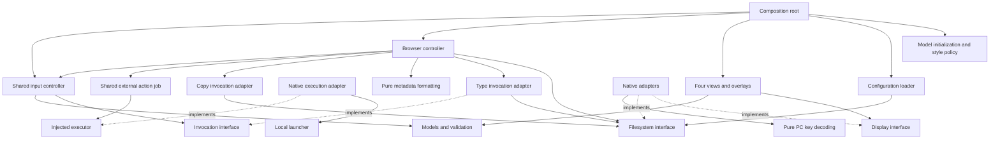

# FM design

Four persistent views: **Device, Files, Actions, Help**. Dialogs and the Type
viewer are temporary overlays. The distributed executable browses CP/M and FAT locations.

## Architecture (C4)

Context: a user browses CDOS files through a native console. One Aztec C executable
contains portable models/controllers/views and native adapters. Host tests link
portable units with injected services; PCE checks the native ABI and screen flow.

Input is translated to a named command once. The shared controller owns pane
navigation and marking; its injected action handler routes real commands to the
browser. The browser owns location and binds the Type and Copy services; the shared controller owns modal job state. Backend services never
receive a view model, draw, or read keys. The single main loop owns input/output.

## Invariants and enforcement

These are acceptance rules. “Pending” means a rule is required but not yet fully
enforced; it must not be represented as completed merely because it is documented.

| Area | Invariant | Current evidence/status |
|---|---|---|
| Ownership | The application owns one authoritative mutable model per view; views only borrow it. Borrowed immutable data outlives every use. | Active model contracts; removed duplicate details state. Borrowed storage remains valid throughout each use. |
| IoC | Concrete implementations are selected only by composition. Controllers and views receive interfaces with explicit contexts. No service locator. | Injected display, action, filesystem and job tables; main binds adapters. |
| Dependencies | No view-to-controller, backend-to-view, or controller-to-renderer dependency; no cycles. | Shared validation in model.c; isolated views link without controller/adapters. |
| Rendering | Rendering cannot modify models or perform input/filesystem operations. | Const host signatures; byte-for-byte model checks with recording output. |
| Selection | A selected index is valid or -1; marks are independent; navigation keeps the cursor visible. | Model bounds checks and controller navigation tests. |
| Empty lists | Count zero implies selected=-1 and first=0. | Model validation and empty-list tests. |
| Focus | Exactly one underlying pane has focus. A modal captures input without changing that pane. | Validation rejects both/neither; modal input routing precedes pane routing. |
| Invocation | Keyboard/menu actions use the same identifier and interface, never a menu index as an operation. | Named command IDs shared by menus and keyboard bindings. |
| Modal safety | Validate kind, geometry, option pointers/counts, selection and input cursor before any frame output. | Pure prevalidation; malformed/unterminated dialog tests emit no output. |
| Cancellation | Uncommitted dialog changes are discarded. Job cleanup precedes a terminal outcome. | Injected Type/Copy cancellation tests. Type closes on EOF, error and cancellation; browser cancellation preserves location and marks. |
| Output safety | Every run fits its panel/screen; selected fields include trailing space. | Recording display asserts bounds; clipping and highlight tests. |
| Display lifecycle | Every successful begin has one end, including output failure. | Injected write/end failures tested. A failed frame can be partial; atomic presentation is not promised. |
| Native resources | Do not hold the screen mutex across keyboard waits or BDOS I/O. | Adapter separates screen write/repaint and input paths. Filesystem handles belong to the injected adapter; Type owns their lifetime. |
| Error contracts | Invalid model and failed output have distinct outcomes; optional services must not imply success. | FM_BAD_MODEL, FM_OUTPUT_ERROR and recoverable FM_JOB_ERROR; active callback and navigation-data checks. Job failure produces an overlay, not application exit. |
| Memory | Bound counts/writes; validate indices before access; avoid large native stack allocations. | Validated bounds; the catalog uses an injected allocator, while application/canvas storage remains static. Borrowed strings must be valid NUL-terminated strings. |
| State transitions | Reject stale operation selections/replies and invalid job transitions. | Invocation/decision tokens, listing generation and result bounds checked. Stale replies/results and adapter failures tested. |
| Partial outcomes | Completed, failed and unprocessed items remain distinguishable. | Ordered successful/failed prefixes and unprocessed suffix; failure after one item and cancellation after progress tested. No arbitrary out-of-order results. |
| Readability | Descriptive names, consistent formatting, comments explaining decisions, no unexplained policy constants. | Named commands and bindings, expanded controller branches and documented navigation/job policy. Full interface prototypes on native and host builds; touched files use ANSI definitions. |
| Documentation | Headers define ownership, lifetime, arguments and errors. Documentation describes actual behaviour and names outstanding gaps. | fm.h and this document; no claim of original-FM parity. |
| Testability | Units run through injected interfaces without PCE, native libraries, replaced globals or included implementation files. | tests/views.c injects recording/failing output; Type/Copy/browser tests inject failing filesystem services. |
| Verification | Test boundaries, failure cleanup and state transitions, not merely successful examples. Verify native compiler/ABI separately. | Host tests built with warnings as errors; Aztec native build; separate PCE suite. |

## Interface contracts

| Interface | Contract |
|---|---|
| View models | Application-owned; views borrow immutable data during rendering. Referenced strings/lists must outlive use. |
| Display | Context plus begin/write/end; counted bounded writes; every successful begin has one end, including failures. |
| Command routing | `fm_dispatch_to` maps keyboard/menu to a named command and invokes the injected action handler. No filesystem or rendering calls. |
| Filesystem | Context plus drive/probe, listing and file operations. Caller-owned buffers; opaque handles; successful opens require close. Restore process drive/user/DMA before returning. |
| Type | Caller-owned state/page buffer; reads bytes through the filesystem port; handles CR/LF, tabs, wrapping and Ctrl-Z. Closes on EOF/error/cancel. |
| Actions | invoke/advance/cancel; application-owned immutable requests borrowed until cancellation/completion; invocation and decision tokens reject stale replies; generation protects targets. Ordered success/failure prefixes retain partial progress. VIEW results borrow page data; cancellation reports cleanup errors. |

Browser state is allocated for the session. Open initializes fresh or previously
closed state; close must precede reuse. Real Type and Copy share invoke/advance/cancel, request snapshots, generation
checks and controller-owned presentation. Services receive no mutable UI model.

## Modules

| Module | Responsibility |
|---|---|
| fm.h, location.h, type.h, browser.h | Model and service contracts, ownership and capacities |
| ui.c | Layout, command/hint descriptors, model initialization and validated style application |
| config.c, config.h | Colour parsing/loading through the filesystem port |
| keys.c | Pure PC-byte decoding into semantic keys |
| model.c | Pure validation and target resolution |
| view.c | Four read-only renderers, overlays and clipping |
| control.c | Shared key/command routing, pane selection, generic dialogs and job coordination |
| browser.c | Catalog ownership, accepted-location commits and action service binding |
| locpick.c, locpick.h | Shared bounded drive/user/directory picker; candidate and bookmark snapshots |
| type.c | Read-only text paging and invocation adapter, independent of display/controllers |
| fsnative.c | Native CP/M/FAT adapter; mapping, read operations and transactional Copy storage |
| copy.c, copy.h | Binary Copy state machine and injected transaction contract |
| backup.c, backup.h | BackRest control generation and confirmation; injected storage/host ports |
| backupos.c | Physical-directory guard around the shared executor |
| mutate.c | Confirmed Rename/Delete/attribute jobs |
| run.c, runos.c | Launch policies and native console/process handoff |
| canvas.c | Text and attribute frame buffer |
| native.c, xios.asm, fsmap.asm | Native display/input, OS bridge and read-only mapping identity lookup |
| main.c | Production allocation, dependency injection and event loop |

## Selection and action flow

Cursor and marks are independent. Type uses marked files in listing order,
otherwise the cursor. Empty targets are rejected; the main catalog contains files only. Directory navigation belongs to the location picker.
A location commit clears marks and increments generation. Cancelling a picker
changes neither location nor selection. Type captures targets before opening;
its overlay blocks browser navigation and preserves cursor, focus and marks.
F3 resolves the current selection again; it never replays an old target snapshot.

Real Copy is accepted for the documented file-copy scope.
Program launching uses the shared injected executor; policies are in `run.c`.

## Keybinding progress

| Binding | Real browser |
|---|---|
| Tab; arrows; Home/End; PgUp/PgDn | Same shared routing |
| Space/comma/Insert; Delete | Same shared routing |
| F4 / Ctrl-X | Clear marks |
| F2 / file Enter | Read selected/marked files |
| F3 | Resolve current targets and repeat the last action |
| F1 | HELP.CMD with optional topic |
| F9 | CP/M user picker; FAT file-pane focus |
| Drive Selection menu | Probe drive, then CP/M user or FAT root |
| Esc | Cancel picker/viewer; leave Setup submenu; otherwise exit |
| C | Shared location picker and Copy job lifecycle |
| F7/F8 | Store/Go/Clear for two locations; inside location picker, browse bookmark |
| Subset menu | Validated 8.3 mask on the files-only catalog |
| F5/F6; F10 | Run selected program / DREDIX / external command line |
| Backspace / Enter on `..` | Return to FAT parent |
| Space/PgDn/Enter in Type | Next page/file; Esc returns |
| PgUp/Home/End in Type | Previous/first/last page; replay can be cancelled |
## Mandatory review gate — every iteration

Before reporting completion, inspect the changed code and affected contracts:

- MVC: passive views; controller-owned interaction; no backend UI/input calls.
- IoC: explicit context-bearing ports, composition-root bindings, injectable tests.
- Modularity: one clear responsibility per module; no new cycles or tiny-file sprawl.
- Safety: bounds, state transitions, borrowed lifetimes, resource cleanup, rollback.
- Readability: consistent indentation, expanded branches, meaningful names and comments.
- Naming: meaningful 8.3 source, test and generated executable names.
- Documentation: behaviour, keybindings and limitations agree with code.
- Verification: host boundary/failure tests plus native ABI acceptance where affected.

Report unresolved violations explicitly. Passing tests alone does not satisfy
this gate. Native read/write operations share mapping internals in fsnative.c.

Copy uses prepare/begin/write/commit/abort storage operations. Controllers call
fm_copy_configure rather than editing job fields. Publication retains the old
file until the complete temporary is closed; failed rollback preserves a named
backup. File replacement is not an atomic transaction against power loss or
concurrent writers. Native Copy acceptance passed with persisted byte comparisons.

## Current state and ownership

The archived mock and historical phase notes are in `garbage/mock`; nothing
there is built or used by production. The active application supports location
selection, marking, filtering, directory slots, metadata, Type and Copy.
Current action coverage and the code budget are tracked in model.md.

The application owns the action request until completion/cancellation. Type and
Copy borrow it rather than duplicating its target array. Catalog storage uses
an injected allocator, grows from 32 entries to at most 1,024, and is released
by the browser. Failed growth reports a valid partial listing with an error.
The real model contains no fixture places, mock bookmarks or simulated-job state.

Ten production host suites and the compiled dependency check validate the
remaining boundaries. Test filesystem implementations stay inside tests; they
are dependency-injection tests, not an alternate application. Native acceptance
uses the single production program on disposable CP/M and FAT images.

## Factoring review

Removed unreferenced DATASEG/FMTSTATE assembly entry points. Configuration's
bounded decimal parser is shared by colour and geometry assignments; invalid
and overflowing input leaves prior values intact. Browser overlays reuse the
UI reset/info helpers, retaining their existing coordinates and cancellation
behaviour. No modules or service dependencies were added. `-q1000` is a measured
compiler setting, not a change to the application's contracts.

## File mutation boundary

`browser -> mutate -> injected mutation store -> fsnative -> BDOS`.
The mutation job owns request/confirmation sequencing, not rendering or OS calls.
The native store reuses Copy's closed-FCB workspace; the composition root binds
it and the controller serializes actions. No job allocates a second target list.
Rename refuses overwrite; Delete operates on one exact name per accepted reply.

Jobs may request bounded text through FM_JOB_INPUT/FM_REPLY_TEXT. The controller
uses the same input editor as ordinary dialogs; actions never read keyboard
input or access views. Text is borrowed during advance and copied by the job
when retained. Decision tokens reject stale input and confirmation replies.

## External execution contract

`browser -> run -> fm_executor` is the portable action path. `main` injects
`runos`, which uses local `spawn` and the native filesystem/console adapters.
Views and input controllers have no process-launch dependency. All external
actions and F10 are entries in one policy table, not separate implementations.

- The browser resolves zero or one files and owns the immutable request.
- The job copies the executable prefix, requests optional text through the
  existing input contract, checks the complete 127-character bound, and invokes
  the executor exactly once for a matching decision token.
- Zero-file requests are valid for Help, disk utilities and F10. Other jobs still
  enforce their own file-count requirements. No dummy catalog entries exist.
- The executor borrows the location and command only during its synchronous call.
  It requires closed handles, yields the console, waits for the child, restores
  drive/user/DMA and reopens the display on both launch success and failure.
- Child output remains visible until a keypress. Child exit status is not exposed
  as launch status. If console reopening fails, FM reports an output failure
  rather than continuing to draw against an invalid console.
- Native FAT path mapping is shared with file I/O. There is no second path mapper.
  Selection/catalog refresh happens only after execution has ended.

Quality review: ANSI interfaces, bounded formatting, no view calls from the
portable job, no sibling build dependency, no direct module cycles. Host tests
inject execution and exercise every policy, cancellation, invalid/replayed
responses and errors. Native tests cover actual process return and locations.

## Printing contract

`browser -> print -> fm_printer/fm_filesystem` follows the existing job protocol.
The browser owns the immutable selection; the job borrows it until cancellation
or completion. Each advance processes at most one 128-byte record. Views never
perform printer I/O. `main` injects the native printer adapter; host tests inject
an ownership-aware byte sink and failing filesystem operations.

The job closes each opened file and releases each acquired printer exactly once.
Completed marks are cleared only during that job, allowing subsequent reselection.
Native output may wait for hardware; record-sized advances do not make BDOS
printer writes asynchronous. No additional dependency cycle is introduced.

## Display and volume information

Selection arrows are view policy driven by the existing cursor/focus models.
The browser queries optional filesystem `space` only after closing enumeration;
the adapter returns free KiB and restores DMA/user state. Views perform no I/O.

Canvas spans use runtime bulk memory operations. The native adapter holds the
existing screen lock for one bounded 1,920-cell transfer and releases it before
calling XIOS. The transfer compares against the authoritative virtual image;
unchanged frames need no redraw. No shadow buffer or kernel changes are needed.
Host tests cover marker/focus rendering, large/full/error space results and
presentation lock/redraw behaviour; native checks cover the assembled transfer.

## Setup/Backup review

Setup uses existing menu models, mutation/Copy jobs and launch policies. Backup
owns no UI state and calls only injected host/storage interfaces. Native directory
restoration surrounds the existing executor, including failure returns. No second
launcher, sibling-project dependency, or kernel change was introduced. Compiled
dependency and host fault-injection checks pass. Native tests cover the composed
Setup/Backup path; single-volume BACK/REST recovery is verified on disposable FAT and CP/M disks
by deleting originals and comparing every recovered byte.

### Location picker ownership

`locpick.c` owns a candidate location and a bounded page of directory labels.
It receives the filesystem port and dialog model; it never touches the main
catalog, marks or job request. Browser commits an accepted location or configures
Copy with it. Cancellation leaves the source unchanged. Every enumeration closes
before returning. Directory paging rescans rather than allocating another catalog.

Views remain passive. The Actions model owns its dynamic Size/Date label; the
renderer receives the label without inspecting browser or filesystem state.
Both selection gutters retain normal colour independently of the highlighted text.

With no marks, the current file uses target colour without `*`. When marks
exist, only marked files use target colour. Reverse video and the caret identify
keyboard focus in the active pane; `*` persists independently of focus. Copy context comes from its immutable target
snapshot. Location dialogs expose navigation through footer controls, not
pseudo-directory entries. Empty directories remain valid destinations.
